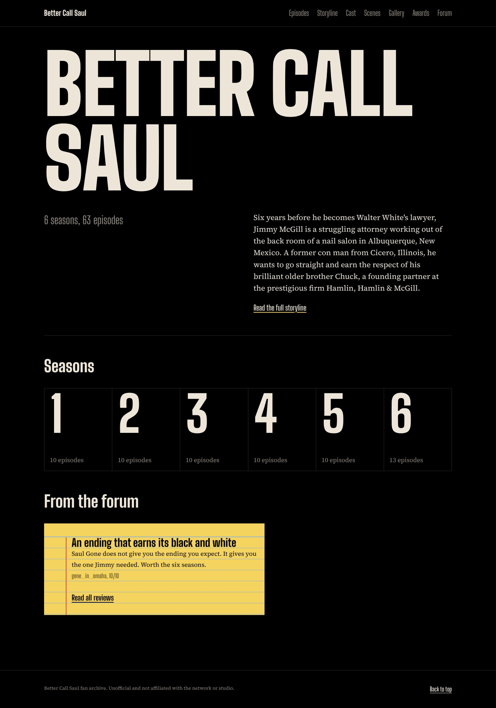
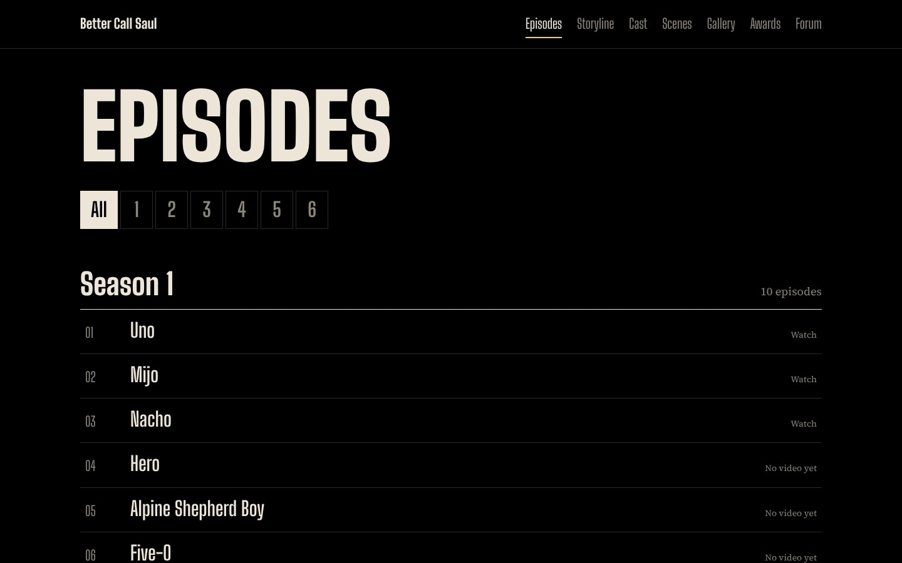
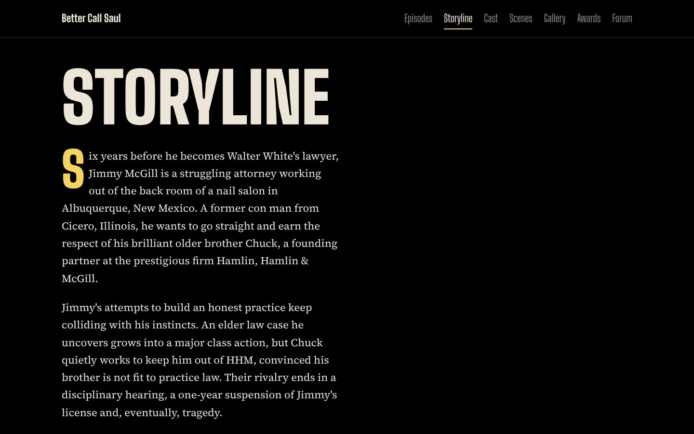
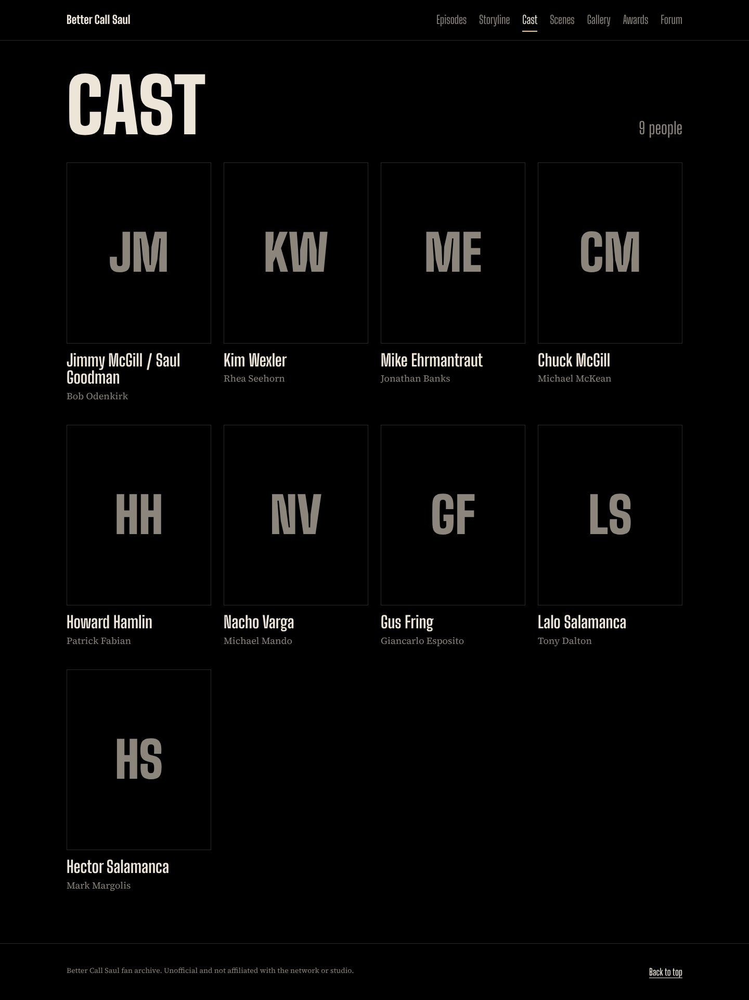
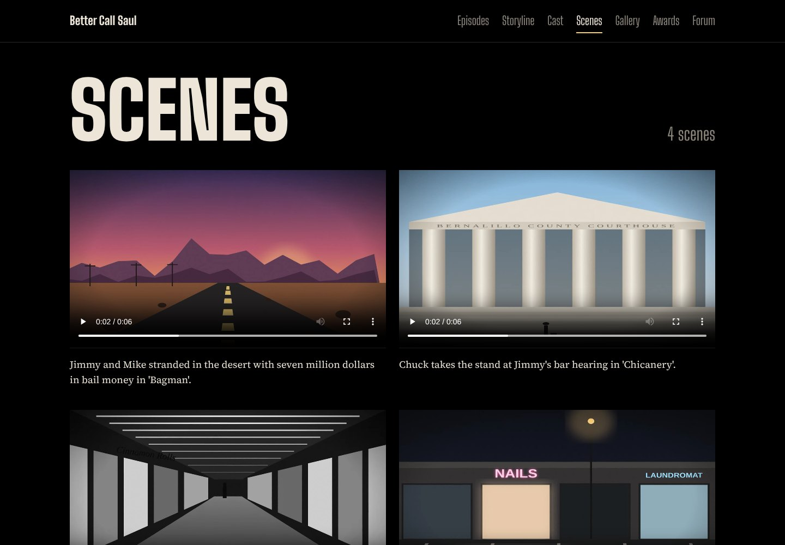
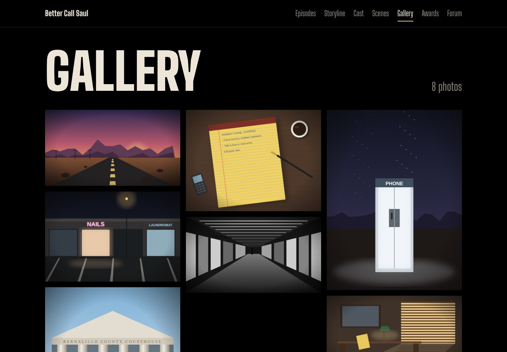
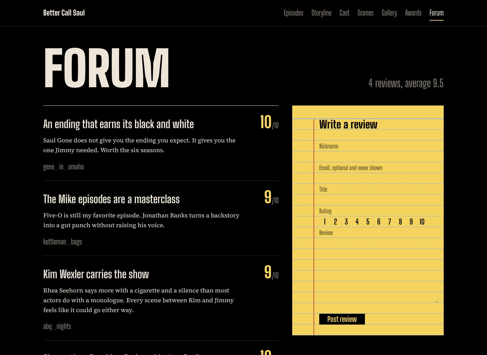
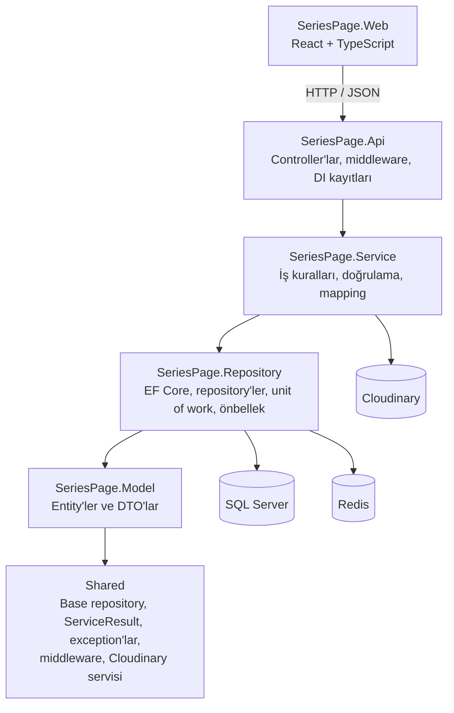
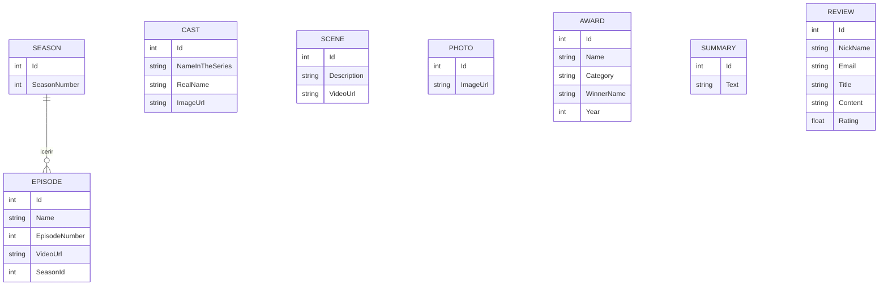

# SeriesPage

SeriesPage, tek bir diziye adanmış full-stack bir platformdur. Dizinin hikâyesini, sezonlarını ve bölümlerini, oyuncu kadrosunu, sahnelerini, fotoğraf galerisini, ödüllerini ve bir hayran forumunu tek bir yerde toplar. Backend katmanlı bir **.NET 8 Web API**, frontend ise Vite ile oluşturulmuş bir **React + TypeScript** tek sayfa uygulamasıdır.



## Ekran görüntüleri

| Bölümler                                   | Bölüm detayı                                         |
| ------------------------------------------ | ---------------------------------------------------- |
|  |  |

| Hikâye                                    | Oyuncu kadrosu                               |
| ----------------------------------------- | -------------------------------------------- |
|  |  |

| Sahneler                                 | Galeri                                  |
| ---------------------------------------- | --------------------------------------- |
|  |  |

| Fotoğraf görüntüleyici                                         | Ödüller                                 |
| -------------------------------------------------------------- | --------------------------------------- |
|  |  |

| Forum                                | Mobil                                                |
| ------------------------------------ | ---------------------------------------------------- |
|  |  |

## Kullanılan teknolojiler

### Backend

| Teknoloji                                | Nerede kullanıldı                | Nasıl kullanıldı                                                                                                                                                                       |
| ---------------------------------------- | -------------------------------- | -------------------------------------------------------------------------------------------------------------------------------------------------------------------------------------- |
| **.NET 8 / ASP.NET Core Web API**        | `SeriesPage.Api`                 | Primary constructor'lar ve attribute routing ile controller tabanlı bir REST API. Servis sonuçlarını HTTP cevaplarına çeviren ortak bir `CustomBaseController` kullanılır.             |
| **Entity Framework Core 8 + SQL Server** | `SeriesPage.Repository`          | Code-first veri erişimi. `AppDbContext`, assembly'deki tüm `IEntityTypeConfiguration` sınıflarını uygular; entity'ler Fluent API ile yapılandırılır ve şema migration'larla yönetilir. |
| **Redis (StackExchange.Redis)**          | `SeriesPage.Repository/Episodes` | `IDistributedCache` üzerinden çalışan `EpisodeRepositoryWithCache`, bölüm listesini ve tekil bölümleri önbelleğe alır, yazma işlemlerinde önbelleği temizler.                          |
| **Scrutor**                              | `RepositoryExtensions`           | `services.Decorate<IEpisodeRepository, EpisodeRepositoryWithCache>()` ile EF repository'si, onu kullanan servislere dokunmadan önbellek katmanıyla sarılır.                            |
| **AutoMapper**                           | `SeriesPage.Service/*/Profiles`  | Her özellik için bir mapping profili; request DTO'larını entity'lere, entity'leri response DTO'larına dönüştürür.                                                                      |
| **FluentValidation**                     | `SeriesPage.Service/*/Validator` | Request validator'ları `AddFluentValidationAutoValidation` ile otomatik çalışır; uzunluk, aralık, e-posta formatı ve izin verilen dosya türlerini kontrol eder.                        |
| **Cloudinary**                           | `Shared/Services/Cloudinaryy`    | `ICloudinaryService`, oyuncu fotoğraflarını, galeri görsellerini, sahne kliplerini ve bölüm videolarını yükler; veritabanına kaydedilen güvenli HTTPS adreslerini döner.               |
| **DotNetEnv**                            | `SeriesPage.Api/Program.cs`      | Uygulama açılırken `.env` dosyasını okur; böylece connection string'ler, Cloudinary bilgileri ve CORS adresleri kaynak koda girmez.                                                    |
| **Swagger (Swashbuckle)**                | `SeriesPage.Api`                 | Geliştirme ortamında interaktif API dokümantasyonu.                                                                                                                                    |
| **Docker Compose**                       | `docker-compose.yml`             | SQL Server 2022 ve Redis'i kalıcı volume'larla container olarak çalıştırır.                                                                                                            |

### Frontend

| Teknoloji                       | Nerede kullanıldı                        | Nasıl kullanıldı                                                                                                                                             |
| ------------------------------- | ---------------------------------------- | ------------------------------------------------------------------------------------------------------------------------------------------------------------ |
| **React 19**                    | `frontend/SeriesPage.Web/src`            | Tüm sayfalar ve ortak bileşenler fonksiyon bileşenleri ve hook'larla yazılmıştır.                                                                            |
| **TypeScript**                  | Frontend'in tamamı                       | Strict mod açıktır; `src/api/types.ts` backend DTO'larını birebir yansıtır.                                                                                  |
| **Vite**                        | `vite.config.ts`                         | Geliştirme sunucusu ve production build. Geliştirme proxy'si `/api` isteklerini .NET API'ye yönlendirir, böylece tarayıcı her zaman tek bir adresle konuşur. |
| **React Router 7**              | `App.tsx`, `navigation.ts`               | Ortak bir layout altında iç içe route'lar, URL üzerinden sezon filtresi (`/episodes?season=3`) ve bölüm detay sayfaları.                                     |
| **Fetch tabanlı API istemcisi** | `src/api/client.ts`, `src/api/series.ts` | Backend'in `ServiceResult` zarfını açan ve validation `ProblemDetails` dahil tüm hataları tek bir `ApiError` tipine çeviren küçük, tipli bir katman.         |
| **Özel hook'lar**               | `src/hooks/useApi.ts`                    | `useApi` her istek için yükleniyor, hata ve tekrar deneme durumlarını yönetir; `LoadState` bileşeni bu durumlara uygun arayüzü gösterir.                     |
| **CSS değişkenleri**            | `src/styles/tokens.css`                  | Renk, yazı ölçeği, boşluklar ve bloknot deseni için tasarım değişkenleri; her bileşenin stil dosyası kendi yanında durur.                                    |
| **Fontsource**                  | `main.tsx`                               | Kendi sunucumuzdan yüklenen değişken fontlar: başlıklar için Big Shoulders Display, metinler için Source Serif 4.                                            |

## Mimari

Backend katmanlı bir mimariyle kurulmuştur. Her katman yalnızca altındaki katmana bağımlıdır ve her özellik (Bölümler, Sezonlar, Oyuncular, Sahneler, Fotoğraflar, Ödüller, Özetler, Yorumlar) her katmanda aynı düzende yer alır.



### Katmanlar

- **SeriesPage.Api** uygulamanın giriş noktasıdır. Controller'lar ince tutulmuştur: isteği alır, tek bir servis metodunu çağırır ve `CreateActionResult(...)` ile cevap döner. `Program.cs`; CORS, Swagger, global hata middleware'i ve her katmanı kaydeden extension metotlarını bir araya getirir.
- **SeriesPage.Service** iş mantığını içerir. Servisler iş kurallarını kontrol eder (örneğin sezon numarası benzersiz olmalı, bir bölüm var olan bir sezona ait olmalı), medyayı Cloudinary'ye yükler, nesneleri AutoMapper ile dönüştürür ve bir `ServiceResult` döner.
- **SeriesPage.Repository** veri kalıcılığını yönetir. Her özelliğin bir arayüzü ve generic `BaseRepository<TDbContext, TEntity, TId>` sınıfından türeyen bir implementasyonu vardır. Değişiklikler `IUnitOfWork` üzerinden kaydedilir; ne zaman kaydedileceğine servis karar verir.
- **SeriesPage.Model** entity'leri ve DTO'ları barındırır. İstekler değişmez `record` tipleridir; cevaplar ise yalnızca istemcinin ihtiyaç duyduğu alanları taşıyan DTO'lardır.
- **Shared** bu alana özel olmayan ortak yapı taşlarını içerir: `BaseEntity`, `BaseRepository`, `ServiceResult`, `NotFoundException` ve `BusinessException`, `ExceptionHandlingMiddleware` ve Cloudinary servisi.

### Kullanılan desenler

- **Repository ve Unit of Work.** Repository'ler `GetAllAsync`, `GetByIdAsync`, `Where`, `AddAsync`, `Update` ve `Delete` metotlarını sunar; `IUnitOfWork.SaveChangesAsync` değişiklikleri kaydeder.
- **Decorator.** `EpisodeRepositoryWithCache`, EF repository'siyle aynı `IEpisodeRepository` arayüzünü uygular ve üstüne Redis önbelleği ekler; kaydı Scrutor ile yapılır.
- **Result pattern.** Her servis `ServiceResult` veya `ServiceResult<T>` döner. Bunlar veriyi, mesajı, HTTP durum kodunu ve yeni oluşturulan kayıtlar için kaydın adresini taşır. Base controller bunları `200`, `201`, `204` gibi cevaplara çevirir.
- **Merkezi hata yönetimi.** `ExceptionHandlingMiddleware`, `NotFoundException`'ı `404`'e, `BusinessException`'ı `400`'e, diğer tüm hataları `500`'e çevirir ve her zaman aynı JSON yapısını döner.
- **Özellik bazlı klasörler.** Service katmanında her özelliğin `Abstracts`, `Concretes`, `Validator` ve `Profiles` klasörleri; Repository katmanında `Abstracts`, `Concretes` ve `Configuration(s)` klasörleri vardır.

### Veri modeli



### API

Her kaynak `api/[controller]` altında aynı CRUD yapısını sunar ve cevaplar `{ "data": ..., "message": ... }` şeklinde döner.

| Kaynak      | Route          | Açıklama                                                                                                |
| ----------- | -------------- | ------------------------------------------------------------------------------------------------------- |
| Sezonlar    | `api/Seasons`  | Ayrıca `with-episodes` ve `with-episodes/{seasonNumber}`; sezonları bölümleriyle birlikte sıralı döner. |
| Bölümler    | `api/Episodes` | Video dosyaları multipart form ile yüklenir; okumalar Redis'te önbelleğe alınır.                        |
| Oyuncular   | `api/Casts`    | Fotoğraflar multipart form ile yüklenir.                                                                |
| Sahneler    | `api/Scenes`   | Video klipler multipart form ile yüklenir.                                                              |
| Fotoğraflar | `api/Photos`   | Galeri görselleri multipart form ile yüklenir.                                                          |
| Ödüller     | `api/Awards`   | JSON gövde.                                                                                             |
| Özet        | `api/Summary`  | JSON gövde; her özet, hikâyenin bir paragrafıdır.                                                       |
| Yorumlar    | `api/Reviews`  | JSON gövde; e-posta adresleri kaydedilir ama hiçbir zaman geri döndürülmez.                             |

### Frontend yapısı

```
frontend/SeriesPage.Web/src
├── api/          Tipli API istemcisi, endpoint fonksiyonları ve DTO tipleri
├── components/   Layout, header, footer, sayfa başlığı, yükleme durumları, yorum formu ve kartı
├── hooks/        Yükleniyor, hata ve tekrar deneme durumları için useApi
├── pages/        Ana sayfa, Bölümler, Bölüm detayı, Hikâye, Kadro, Sahneler, Galeri, Ödüller, Forum
├── styles/       Tasarım değişkenleri ve temel stiller
├── config.ts     Ortam değişkeninden okunan dizi adı
└── navigation.ts Ana menü öğeleri
```
